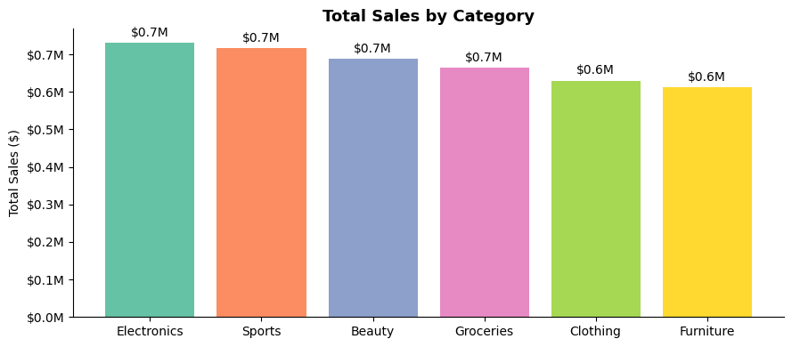
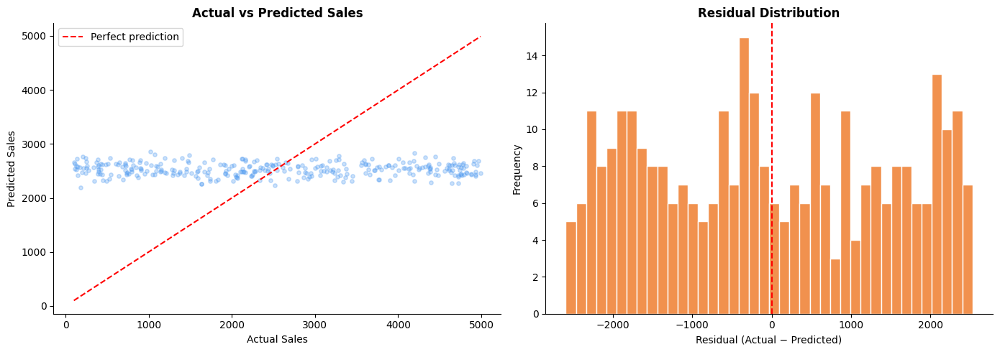

# Retail Sales Analysis & Prediction

End-to-end data project: from dashboards and exploratory analysis to a machine learning prediction, with business recommendations.

Project brief from the **MetBrains 7-day Data Camp (2026)**.

## Goal

A retail company provided 1,600 sales transactions across categories, countries, customer segments, payment modes and sales channels. The aim was to understand what drives sales and profit, and to test whether sales can be predicted.

## Tools

- **Tableau** – interactive dashboard (Part 1)
- **Python** – pandas, NumPy, Matplotlib, Seaborn (Part 2)
- **scikit-learn** – Linear Regression (Part 3)
- **Google Colab** – notebook environment

## Project structure

```
retail-sales-analysis-prediction/
├── retail_analysis.ipynb   # EDA, model and insights
├── images/                 # key charts from the notebook
├── data/                   # dataset (see data/README.md)
├── requirements.txt
└── README.md
```

## Key findings

| Question | Finding |
|---|---|
| Best category | Electronics, but all six categories are close ($0.6M–$0.7M) |
| Strongest markets | India, then UAE and Australia; the UK is the weakest |
| Customer segments | Almost even: Home Office 35.4%, Corporate 32.8%, Consumer 31.8% |
| Discount vs profit | Almost no relationship (r = −0.03) |
| Sales prediction | Linear Regression R² = −0.01, MAE ≈ $1,300 |





## What the model result means

The model predicts almost the same value (about $2,500) for every order, so it does no better than the average. Together with near-zero correlations and evenly spread distributions, this suggests the dataset is close to randomly generated. The main lesson: check whether data contains real patterns before reaching for more complex models.

## Next steps

- Replace label encoding with one-hot encoding
- Test tree-based models (Decision Tree, Random Forest)
- Predict profit margin instead of sales
- Apply the same workflow to a real retail dataset

## Tableau dashboard

Link: _add your Tableau Public link here_

## How to run

1. Open `retail_analysis.ipynb` in Google Colab or Jupyter.
2. Install the packages in `requirements.txt` if needed.
3. Run all cells and upload the dataset when asked.

## Author

**Berkant Duman** – MSc Business Management (Data Analytics & AI), Steinbeis Hochschule
